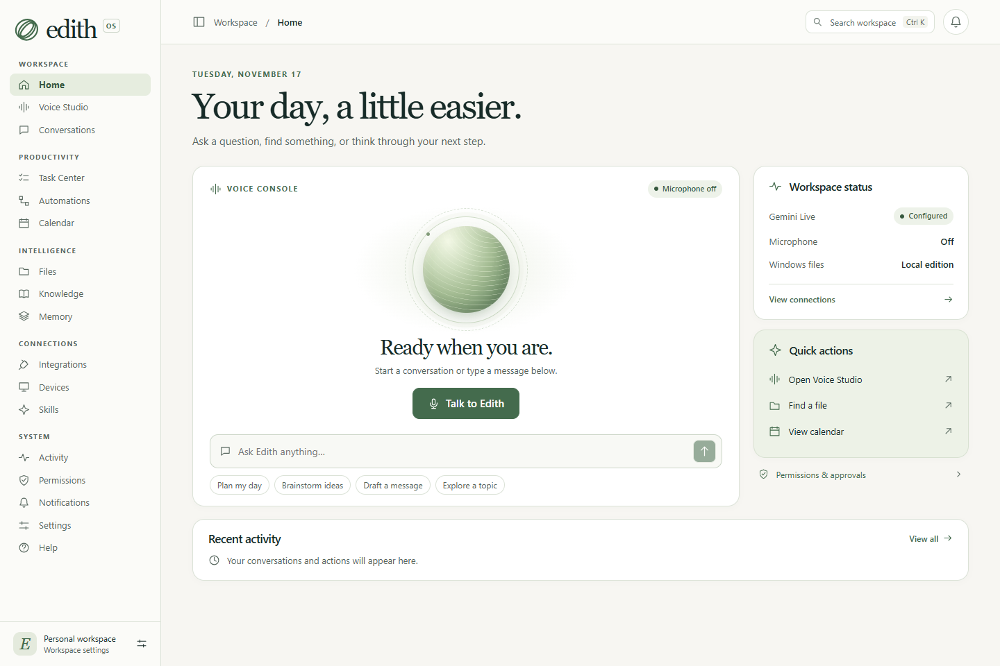
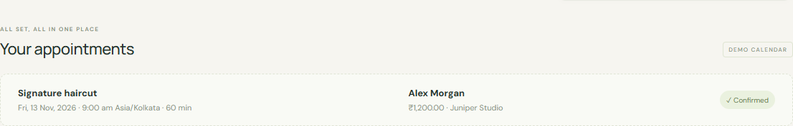
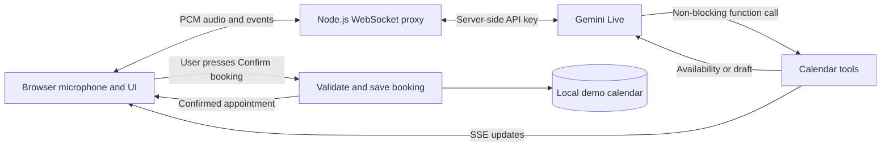

<div align="center">

# EDITH OS

### A personal workspace for voice and text.

Talk to Edith or type a question. The workspace includes live captions, keyboard navigation, session activity and authorized local filename search on Windows.


[Quick start](#quick-start) · [Screenshots](#screenshots) · [Tech stack](#tech-stack) · [Configuration](#configuration) · [Tests](#tests)

</div>



Start with `npm ci` and `npm start`, then open [the workspace](http://localhost:3000/app). Gemini voice and typed answers use the same server-side credential. Press Ctrl+K (⌘K on Mac) to find a page. Transcripts and activity last for this visit. The hosted release has no paired PC. Task execution, automation, knowledge, memory and OAuth have availability pages.

The [appointment demo](http://localhost:3000/demo) retains its calendar, booking controls and business configuration. The sections below describe the local Windows tools and the legacy demo. See the [architecture](docs/architecture.md), [migration and verification](docs/edith-migration-plan.md), and [mobile preview](docs/screenshots/edith-os-mobile.png).


## Phase 2: persistent local file intelligence

The existing Edith experience now uses a private SQLite metadata index in a Node worker, with background scanning, bounded file watchers, periodic reconciliation, typo-tolerant filename search, date/type/size/drive filters and session-scoped file references. Gemini and the browser keep using the same secured tool registry. File contents are never indexed or sent to Gemini.

- [Baseline audit](docs/edith/PHASE2_BASELINE_AUDIT.md) · [Architecture](docs/edith/PHASE2_ARCHITECTURE.md) · [Database schema](docs/edith/PHASE2_DATABASE_SCHEMA.md)
- [Search design](docs/edith/PHASE2_SEARCH_DESIGN.md) · [Indexing design](docs/edith/PHASE2_INDEXING_DESIGN.md) · [Test and performance report](docs/edith/PHASE2_TEST_REPORT.md) · [Full handoff](docs/edith/PHASE2_HANDOFF.md)

**Windows prerequisites:** Node 20.11+, npm, Windows Explorer, and Microsoft Edge at a trusted installed path for PDF opening. SQLite is bundled as pinned WebAssembly (`node-sqlite3-wasm`); no C++ compiler or runtime upgrade is required. It uses one worker-owned connection and rollback journaling with an exclusive owner lock, rather than assuming WAL support.

```powershell
npm ci
npm start
# Open http://localhost:3000 — this backend also serves the frontend.
npm run check
npm run test:all
npm run test:phase2
npm run benchmark:index
node checks/index-observation.mjs
```

Keep credentials in ignored `.env.local`. Optional selectors: `EDITH_INDEX_CONFIG=config/indexing.jsonc`, `EDITH_SECURITY_CONFIG=config/edith-security.jsonc`, `FILE_TOOLS_CONFIG=config/file-tools.jsonc`. Existing credentials need no change.

**Authorize roots:** edit `config/file-tools.jsonc` and restart. Defaults remain Downloads only. Add explicit local physical paths for Documents/Desktop/Pictures/Videos/projects/OneDrive or a fixed drive root if wanted. The Discover drives button reports available fixed volumes; it does not authorize them. Protected system, credentials, dependency, index and audit directories stay blocked even beneath an included drive.

**First scan:** click Start indexing, or search an empty index. Results may be incomplete while scanning. Use Pause / Resume / Cancel scan in the existing file panel. `config/indexing.jsonc` controls startup scanning (default false), depth/count limits, batches, watcher debounce, reconciliation interval and the user's search timezone (default Asia/Kolkata). Background work does not require voice to stop. Watchers cover up to 256 validated folders; periodic scans repair missed changes. No completion percentage is invented.

**Try:** “Find my latest resume”, “Find PDFs in Downloads”, “Show Excel files modified last week”, “Find files larger than 500 MB”, “Find resmee”, “Find images created this morning”, “Show the biggest files on D drive” (only if authorized). Then “Open the second one”, “Open the newest”, “Show it in Explorer”, or “Open that folder”. Use the panel for filters and next pages. LocalOnly results stay in the local panel; choose them there when the cloud cannot see their references.

**Safe opening:** text uses fixed Notepad arguments; PDFs use the installed Edge PDF viewer with an encoded local-file URL. Scripts/executables and arbitrary associations remain blocked. Office/image files can be searched and revealed. Audio/video/archive types require explicit approval in allowedFileTypes before reveal. Source scripts can be indexed as metadata but remain blocked for both open and reveal. No document content extraction, summarization, file mutation or general app launching is included.

**Rebuild/recovery:** cancel any active scan and wait, open Index settings & maintenance, choose Rebuild metadata index and confirm the reset. Then Start indexing. Only private app metadata is reset; documents stay unchanged. Corrupt indexes are preserved as timestamped siblings. For INDEX_LOCKED, close the other Edith process; never remove a live owner lock. Restart after WORKER_FAILED. Missing drives retain unavailable records until a successful rescan. Permission failures skip affected locations; do not elevate the server to scan protected folders.

**Privacy:** SQLite stores real names/paths/metadata locally under ignored `data/file-index`, with restricted directory ACLs. Do not commit or upload it. Local-only filters apply at cloud egress; speech you intentionally send to Gemini still reaches Gemini. This is a single-account loopback application, with the Phase 1 same-account compromise and path-handoff race limitations documented in the threat model. Performance results and bounded search-window limitations are reported honestly in the Phase 2 test report.

## Phase 1 security foundation

The existing app, Gemini Live connection, calendar, and filename UI are preserved. Phase 1 added a central policy/authorization boundary, protected paths, local-only cloud filtering, expiring cookie sessions with CSRF, exact-operation confirmation contracts, and redacted hash-chained audits. Phase 1 added no database or mutation tools; Phase 2 adds only the metadata database described above. No changes are automatically committed or pushed.

- [Repository audit](docs/edith/PHASE1_REPOSITORY_AUDIT.md)
- [Architecture](docs/edith/PHASE1_ARCHITECTURE.md)
- [Threat model](docs/edith/PHASE1_THREAT_MODEL.md)
- [Executed test report](docs/edith/PHASE1_SECURITY_TEST_REPORT.md)
- [Setup, file inventory and handoff](docs/edith/PHASE1_HANDOFF.md)

`config/edith-security.jsonc` is the validated security config. `EDITH_SECURITY_CONFIG` selects another file; updates take effect after restart, never through an unauthenticated API. Its roots restrict the existing file-tools allowlist, with protected system/credential/dependency paths overriding every setting. Local-only results can remain visible locally but never leave through the Gemini bridge.

**Safer opening:** Open no longer delegates to arbitrary Windows file associations. Phase 1 directly uses the installed Windows Notepad handler for `.txt`, `.md`, `.log`, `.csv` and `.json`. Phase 2 also permits the reviewed Microsoft Edge PDF handler. Office/images can be found and revealed; unsupported opening formats are refused. Executables/scripts cannot be enabled through configuration. Destructive/reversible filesystem execution and Recycle Bin restoration remain unsupported.

**Index configuration:** Phase 2 supersedes `autoStartExistingIndex` with `config/indexing.jsonc` startup/lifecycle controls. SQLite persists metadata across restarts; scanning defaults to off until an authorized request. Explicitly included drive roots are supported subject to immutable protected-path rules.

New security audits are in `data/security-audit/events-<port>.jsonl`, with restricted Windows ACLs. Old `data/tool-audit.jsonl` files are left untouched. New records exclude argument values, private paths, prompts, file contents and credentials. They are append-oriented and hash chained, not tamper-proof against a user/admin who controls the app or filesystem. There is no unrestricted audit download route.

```bash
npm run check
npm run test:security
npm run test:all
npm start
```

The frontend is served by the same backend at http://localhost:3000. A fresh page bootstraps the existing HttpOnly cookie and keeps a CSRF value only in module memory; write requests require both. Reopen/reload after session expiry or after an upgrade from the older app. No key belongs in a URL or browser storage. Same-origin local-session authentication does not defend against a compromised same-account process or replace Windows account authentication.

## What it does

- **Local file assistant:** fuzzy filename search in Downloads, latest-first sorting, and Open / Show in folder actions by voice or click. File contents are never read or sent to Gemini.

Front Desk turns a booking request into a natural conversation. Tell the AI which service you want and when you are free. It checks real availability in the included demo calendar and prepares an appointment for you to review.

- **Live voice conversation:** streaming microphone input, spoken replies, and captions using Google Gemini Live.
- **Interrupt and change your mind:** stop scheduled assistant playback when you speak; change dates, services, or preferences during the conversation.
- **Calendar tools:** non-blocking function calls check available times and prepare booking details on the server.
- **Confirm before saving:** review the service, date, time, name, and price, then press **Confirm booking**. Voice statements alone do not save a booking.
- **Visible appointments:** browse open slots and see confirmed bookings in the UI, with server-side conflict checks.
- **A ready-to-try demo:** Edith includes services and a sample calendar. Manual booking works without an API key.
- **Configurable businesses:** switch branding, services, prices, currency, timezone, hours, and booking rules through JSON.
- **Session controls:** microphone permission handling, mute/unmute, interruption cleanup, and upstream session shutdown.

## Screenshots

These are actual application screenshots captured with fictional demo data. They do not represent a recorded AI conversation.

### Review before saving


### Confirmed appointment



<details>
<summary>View the mobile layout</summary>
<br>

</details>

Regenerate the screenshots with `npm run screenshots`. This uses an isolated in-memory calendar and makes no voice API calls.

## Tech stack

| Layer | Technology | Role |
| --- | --- | --- |
| Voice AI | Google Gemini Live, `@google/genai` | Streaming audio, transcripts, interruptions, and non-blocking function calling |
| Server | Node.js, Express | Application routes, credential handling, configuration, and booking validation |
| Transport | `ws`, browser WebSocket | Server-proxied voice stream; the API key never reaches the browser |
| Browser | HTML, CSS, JavaScript ES modules | Responsive interface, availability, review cards, and appointments |
| Audio | AudioWorklet, Web Audio API | Mono PCM16 capture at 16 kHz, resampling, playback scheduling, and interruption cleanup |
| UI updates | Server-Sent Events | Calendar availability, draft, and booking updates |
| Storage | Local JSON with atomic file replacement | Persistent demo bookings and conflict checks in one server process |
| File tools | SQLite WASM/FTS5, worker_threads, Node.js `fs.watch`, Ajv, JSONC | Persistent filename/metadata search, bounded ranking and background sync |
| Settings | JSON, dotenv, `Intl` | Business configuration, environment settings, currency, timezone and date formatting |
| Tests | Node.js test runner, Playwright | Calendar, audio, browser, alternate-business, and simulated voice verification |

## Quick start

### 1. Install

Use Node.js **20.11 or later** and npm.

```bash
git clone https://github.com/Durga697/NewAgent.git
cd NewAgent
npm ci
```

### 2. Configure voice access

Copy `.env.example` to `.env.local` and set your own `GEMINI_API_KEY` in that local file. Get a key from [Google AI Studio](https://aistudio.google.com/apikey). The selected project must have access to the configured Live model and sufficient quota.

On PowerShell:

```powershell
Copy-Item .env.example .env.local
```

On macOS/Linux:

```bash
cp .env.example .env.local
```

In local development, `.env.local` takes precedence over inherited shell settings; restart the server after changing it. Production and test processes (`NODE_ENV=production` or `test`) skip `.env.local` and keep their explicitly supplied environment values. `.env` supplies remaining defaults. Environment files are ignored by Git. The included `.env.example` has no credential. You can skip voice configuration and still try the manual demo calendar.

### 3. Start

```bash
npm start
```

Open [http://localhost:3000](http://localhost:3000). Press **Start a conversation**, allow microphone access, and tell the concierge what you would like to book. Voice API usage starts only when a conversation is started; provider charges and limits apply.

Try: “I'd like a haircut tomorrow afternoon.” Then change your preference: “Actually, make that the morning.” Review the final card and press **Confirm booking**. Use **Finish conversation** when done.

Microphone capture requires localhost or HTTPS. Finish stops microphone capture and playback and closes the browser and Gemini connections. Leaving the page also requests cleanup.

## How the AI flow works



The browser sends mono PCM16 audio in 32 ms frames. The server connects to Gemini and owns tool execution. Audio returns to the browser for scheduled playback; an interruption discards queued output. Canceled tool calls are ignored. A review card is invalidated when spoken preferences change, and confirmation rechecks availability before writing a booking.

The current implementation uses **Gemini Live**, with `gemini-3.8-live` as its configured default. It does not require OpenAI credentials or external calendar integrations.

## Configuration

Edit [`config/business.json`](config/business.json) and restart. The UI, calendar engine, voice prompts, and tool service IDs all use this shared configuration.

| Setting | What it changes |
| --- | --- |
| `name`, `tagline`, `address` | Business identity shown in the UI and used by the AI |
| `voiceStyle` | Accent, language, pacing and clarification guidance for the AI |
| `timezone`, `locale`, `currency` | IANA timezone, date/time display, and price formatting |
| `services` | Unique service IDs, names, durations, prices, and descriptions |
| `calendar.opensAt`, `calendar.closesAt` | Local opening hours in `HH:mm` format |
| `calendar.slotMinutes` | Available start-time interval |
| `calendar.bookingWindowDays` | How far ahead users can book |
| `calendar.openWeekdays` | Open days; Sunday = `0`, Saturday = `6` |
| `calendar.blockedTimes` | Recurring unavailable periods; use `[]` for none |

Configuration is validated at startup. Daylight-saving gaps are omitted; repeated local times use their first occurrence. Overnight opening hours are not supported.

An alternate [Harbour Clinic configuration](config/examples/clinic.json) demonstrates different branding, services, GBP prices, London time, and weekday hours.

### Server environment

| Variable | Default | Purpose |
| --- | --- | --- |
| `GEMINI_API_KEY` | Unset | Private server credential for voice |
| `GEMINI_LIVE_MODEL` | `gemini-3.8-live` | Gemini Live model; availability depends on your project |
| `GEMINI_VOICE` | `Kore` | Assistant voice |
| `VOICE_MAX_MINUTES` | `10` | Per-conversation duration limit |
| `PORT` | `3000` | Local server port |
| `BUSINESS_CONFIG` | `config/business.json` | Business JSON file |
| `CALENDAR_FILE` | `data/bookings.json` | Booking storage; `:memory:` disables persistence |

For a different business, set `BUSINESS_CONFIG=config/examples/clinic.json` and choose a separate `CALENDAR_FILE`. Changing the timezone or schedule does not migrate existing appointments. New bookings retain their confirmed business name, currency, and timezone.

## Tests

```bash
npm test
npm run test:browser
npm run test:voice
npm run test:config
```

The browser checks use installed Microsoft Edge in headless mode. Screenshot capture also supports `BROWSER_CHANNEL` if another installed Playwright browser channel is preferred.

| Command | Coverage |
| --- | --- |
| `npm test` | Calendar validation and conflicts, confirmation behavior, configuration, DST conversion, and PCM resampling at 44.1/48 kHz |
| `npm run test:browser` | Review/confirm flow, stale and repeated submissions, origin checks, microphone denial recovery, and mobile overflow |
| `npm run test:voice` | Actual Gemini SDK and browser audio code against a local provider double: tools, PCM capture, captions, playback, interruption, cancellation, mute, and shutdown |
| `npm run test:config` | Alternate clinic configuration rendered in the browser |

Voice checks use a local test double and make no paid API calls. They do not establish that a real credential, microphone, model access, or quota will work in every environment.

## Project structure

```text
config/                  Business configuration and an alternate clinic example
public/                  Browser UI, styles, audio capture, and playback
checks/                  Browser, simulated voice, config, and screenshot checks
test/                    Calendar, configuration, date, and audio unit tests
docs/screenshots/        Real screenshots used in this README
server.mjs               HTTP routes, SSE, Gemini connection, and tool execution
calendar.mjs             Availability, drafts, confirmation, and local persistence
config.mjs               Startup validation and server settings
dates.mjs                Business-date arithmetic and timezone conversion
.env.example             Credential-free environment template
```

## Demo scope

This is a single-process local demo bound to loopback. Bookings persist in `data/bookings.json`, and each browser sees appointments created in its current server session. Environment files, local booking data, dependencies, and logs are excluded from Git.

For public deployment, add authentication, HTTPS-aware origin checks, rate and cost controls, session expiry, and a transactional database. Provider GoAway events or connection expiry end the current demo voice session; start a new conversation to continue.

## API references

- [Google Gemini Live model](https://ai.google.dev/gemini-api/docs/models/gemini-3.8-live)
- [Live API function calling](https://ai.google.dev/gemini-api/docs/live-api/tools)
- [Live WebSocket reference](https://ai.google.dev/api/live)
- [Audio streaming and interruptions](https://ai.google.dev/gemini-api/docs/live-api/best-practices)

Edith uses configurable Indian English voice guidance, including clarification of names, dates and times. Accent is requested through system instructions; the generated accent can vary between sessions. Native Live audio does not require a forced language-code setting.

## Local computer tools (Windows v1)

The existing Node server now owns a separate `tools/` layer. The Gemini connection uses declarations generated by `ToolRegistry`, which validates every call with Ajv and writes a local audit record. The booking tools still work alongside normal conversation.

### Run and try each stage

```bash
npm ci
npm test                 # Guards, ranking, filters, IDs, consent and existing calendar/audio tests
npm run test:files       # End-to-end file voice/UI flow against a local Gemini test double
npm run test:voice       # Existing voice + booking regression check
npm run test:browser     # Existing booking browser flow
npm run test:config      # Alternate-business regression check
npm start               # Live assistant at http://localhost:3000
```

The integration check creates fictional files in a temporary folder. A **test-only Node preload** intercepts `explorer.exe`, Notepad and Edge; no actual document app opens, no personal files are searched, and no paid AI requests are made. Production never imports that preload. The normal live assistant uses the real Windows adapter.

On an authorized search, Edith starts the worker-backed metadata index and bounded validated-folder watchers; startup itself does not crawl user files. The UI reports indexing progress; searches during the initial scan return an incomplete-results warning. Normal conversation and bookings can start while indexing continues. The **Find a local file** panel also works without an AI key. Gemini voice requires your existing valid server credential.

Example voice commands:

- “Edith, what folders can you access?”
- “Find my latest electricity bill in Downloads.”
- “Find electricity bills as PDFs modified after the first of February.”
- “Open the second one.”
- “Show the first one in its folder.”

One match: Edith asks “Open filename?” unless you already asked to open it. Multiple matches: she reads the top two or three, displays the ordered list, and waits. No match: try broader words, another file type, or another **allowed** folder. This is filename search; “find a document about college admission” only matches those words in its filename, not its contents.

### Configure the folder allowlist

Edit [`config/file-tools.jsonc`](config/file-tools.jsonc) and restart. JSON comments are supported. The default is **Downloads only**, under `${home}` for the Windows account running the server. Documents and Desktop are commented-out opt-ins; uncomment a root to authorize it. If Windows has moved Downloads elsewhere, explicitly set its physical local path in this config.

```jsonc
"roots": [
  { "id": "Downloads", "path": "${home}/Downloads" }
  // , { "id": "Documents", "path": "${home}/Documents" }
  // , { "id": "Desktop", "path": "${home}/Desktop" }
]
```

Use `FILE_TOOLS_CONFIG` to choose a different config file. Do not add whole drives just to work around a missing-folder error. The UI reports missing or inaccessible roots; correct the path or Windows permissions and restart.

| Option | Default | Meaning |
| --- | --- | --- |
| `enabled` | `true` | Enable or disable local file tools |
| `roots` | Downloads only | Unique folder aliases and absolute paths; `${home}` expands locally |
| `blockedExtensions` | Script, executable, shortcut and active-document types | Additional case-insensitive deny list; immutable security executable/script blocks cannot be removed through configuration |
| `maxDepth` | `8` | Legacy field retained; Phase 2 uses indexing.jsonc maxDepth |
| `maxFiles` | `20000` | Legacy field retained; Phase 2 uses indexing.jsonc maxFiles |
| `resultTtlSeconds` | `600` | Search-result ID lifetime |
| `maxResults` | `50` | Maximum results returned by one search |
| `maxStoredResults` | `200` | Maximum retained IDs per browser session |
| `auditFile` | Legacy compatibility setting | Active Phase 1 audits use the dedicated security logging directory instead; historical logs are not migrated |

Test processes disable the real allowlist unless an explicit `FILE_TOOLS_CONFIG` is supplied. Do not commit a machine-specific private config, audit log, or file-result screenshot containing personal filenames. Keep local logs under ignored `data/`.

### Tool interface

| Tool | Input | Result |
| --- | --- | --- |
| `list_allowed_folders` | `{}` | Root aliases/paths, availability and index status |
| `search_files` | `{ query, folder?, extensions?, modifiedAfter?, modifiedBefore?, sortBy?, limit? }` | Ordered metadata and opaque result IDs |
| `open_file` | `{ resultId }` | Confirmation request, refusal, or approved Notepad text / Edge PDF handoff |
| `reveal_in_folder` | `{ resultId }` | Confirmation request, refusal, or Explorer selection |

`folder` accepts an allowed alias or a validated subfolder path. `query` is filename words, not a path; typos and reordered words are supported. `extensions` accepts values such as `pdf` or `.pdf`. Dates use `YYYY-MM-DD` (UTC day boundaries, with an inclusive end date) or ISO timestamps with a timezone. Sorts are `modifiedDesc` (default/latest), `modifiedAsc`, `relevance` and `name`. Results contain filename, full path, folder, byte size, modified date, ordinal, expiry and stable session-scoped ID. Contents are never included.

### Security model

- Only root-allowlisted local paths are indexed or acted on. Directory traversal, UNC/network shares, Windows device paths/names, alternate data streams, and ambiguous trailing dots/spaces are rejected.
- Paths are normalized with Windows case-insensitive containment checks and canonicalized to handle 8.3 aliases. Symlinks and junctions are rejected rather than followed, including replacements made after a search.
- Open/reveal accepts **only** an opaque ID issued to the same browser session. The server rechecks real path, file type and identity immediately before handing the request to Windows. Removed, changed, expired, cross-session and blocked results fail.
- Executables, scripts, shortcuts, active document types and extensionless files are blocked by default. The browser/model cannot provide shell commands. The Windows adapter uses `spawn` argument arrays with `shell: false`.
- Voice actions require a recent explicit open/show request, a matching ordinal/filename, or confirmation of a pending file action. Ambiguity returns `confirmation_required`. A UI Open / Show in folder click is itself authorization for that displayed result. Voice authorization is consumed after a successful launch.
- The server still binds to `127.0.0.1`. HTTP mutations and WebSocket upgrades check the origin; host checks reject DNS-rebinding hosts. The session cookie scopes file results. Only authorized non-local-only filename metadata and opaque IDs are shared with Gemini; absolute paths and file contents are not. Clicking search while voice is active supplies that displayed metadata to the conversation so “the second one” refers to the visible list.
- Every registry tool call, including refusals and calendar calls, is logged with timestamp, tool, sanitized argument-key names, result count and outcome. New logs omit argument values and private filenames/paths. Open/reveal does not delete, move, rename or write documents. Existing calendar booking writes and audit-log writes are separate application features.

### Known limitations and extension points

- Windows-first. Search can run on other OSes, but the default open/reveal adapter refuses there. The panel records that Windows received a request; it cannot prove a third-party application displayed the document.
- Recursion and file-count caps may make large folders incomplete. Watcher errors and missing roots are reported. Restart after changing roots or their availability. Recently rewritten files may require a repeated search while watcher metadata catches up.
- Guards reject symlink/junction roots too. Use an explicitly authorized physical folder for redirected Windows folders. Network shares are deliberately unsupported in v1.
- File checks and shell handoff cannot be made atomic across third-party applications. Use user-owned folders, not adversarial shared writable directories. The opened app's own file handlers and behavior are outside Edith's control.
- There is no content search, delete, move, rename, clipboard access, volume control, arbitrary application launching, or Electron packaging.
- Each tool has its own module. `ToolRegistry` generates Gemini declarations from the same schemas used for server validation. `FileIndex` exposes `start`, `search`, `folders` and `close`; the Phase 2 SQLite worker implements that interface and returns the same metadata records. A content provider would need a separate explicit privacy design; it is not enabled by this v1. The result serializer deliberately returns metadata fields only.
