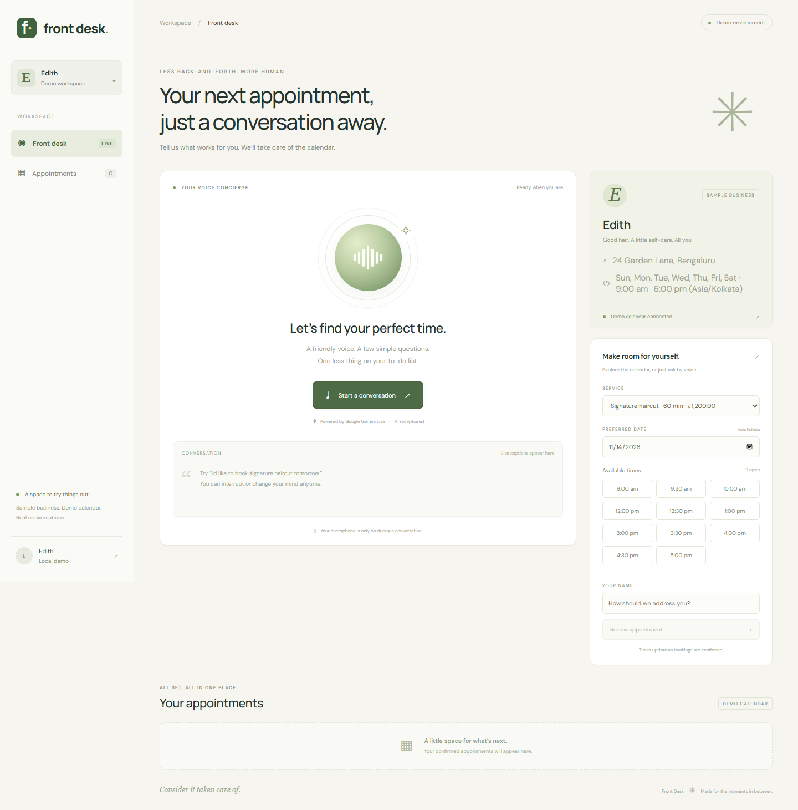
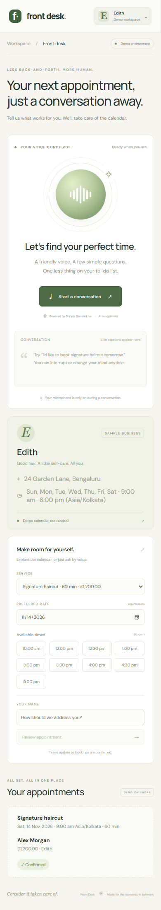
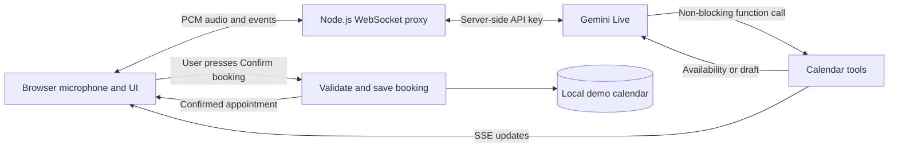

<div align="center">

# Front Desk

### AI-powered appointment booking. Just start talking.

A voice concierge that listens, checks the calendar, and helps you book a time — with a final review before anything is saved.


[Quick start](#quick-start) · [Screenshots](#screenshots) · [Tech stack](#tech-stack) · [Configuration](#configuration) · [Tests](#tests)

</div>



## What it does

Front Desk turns a booking request into a natural conversation. Tell the AI which service you want and when you are free. It checks real availability in the included demo calendar and prepares an appointment for you to review.

- **Live voice conversation:** streaming microphone input, spoken replies, and captions using Google Gemini Live.
- **Interrupt and change your mind:** stop scheduled assistant playback when you speak; change dates, services, or preferences during the conversation.
- **Calendar tools:** non-blocking function calls check available times and prepare booking details on the server.
- **Confirm before saving:** review the service, date, time, name, and price, then press **Confirm booking**. Voice statements alone do not save a booking.
- **Visible appointments:** browse open slots and see confirmed bookings in the UI, with server-side conflict checks.
- **A ready-to-try demo:** Edith includes services and a sample calendar. Manual booking works without an API key.
- **Configurable businesses:** switch branding, services, prices, currency, timezone, hours, and booking rules through JSON.
- **Session controls:** microphone permission handling, mute/unmute, interruption cleanup, and upstream session shutdown.

## Screenshots

These are actual application screenshots captured with fictional demo data. They do not represent a recorded AI conversation.

### Review before saving


### Confirmed appointment


<details>
<summary>View the mobile layout</summary>
<br>

</details>

Regenerate the screenshots with `npm run screenshots`. This uses an isolated in-memory calendar and makes no voice API calls.

## Tech stack

| Layer | Technology | Role |
| --- | --- | --- |
| Voice AI | Google Gemini Live, `@google/genai` | Streaming audio, transcripts, interruptions, and non-blocking function calling |
| Server | Node.js, Express | Application routes, credential handling, configuration, and booking validation |
| Transport | `ws`, browser WebSocket | Server-proxied voice stream; the API key never reaches the browser |
| Browser | HTML, CSS, JavaScript ES modules | Responsive interface, availability, review cards, and appointments |
| Audio | AudioWorklet, Web Audio API | Mono PCM16 capture at 16 kHz, resampling, playback scheduling, and interruption cleanup |
| UI updates | Server-Sent Events | Calendar availability, draft, and booking updates |
| Storage | Local JSON with atomic file replacement | Persistent demo bookings and conflict checks in one server process |
| Settings | JSON, dotenv, `Intl` | Business configuration, environment settings, currency, timezone and date formatting |
| Tests | Node.js test runner, Playwright | Calendar, audio, browser, alternate-business, and simulated voice verification |

## Quick start

### 1. Install

Use Node.js **20.11 or later** and npm.

```bash
git clone https://github.com/Durga697/NewAgent.git
cd NewAgent
npm ci
```

### 2. Configure voice access

Copy `.env.example` to `.env.local` and set your own `GEMINI_API_KEY` in that local file. Get a key from [Google AI Studio](https://aistudio.google.com/apikey). The selected project must have access to the configured Live model and sufficient quota.

On PowerShell:

```powershell
Copy-Item .env.example .env.local
```

On macOS/Linux:

```bash
cp .env.example .env.local
```

In local development, `.env.local` takes precedence over inherited shell settings; restart the server after changing it. Production and test processes (`NODE_ENV=production` or `test`) skip `.env.local` and keep their explicitly supplied environment values. `.env` supplies remaining defaults. Environment files are ignored by Git. The included `.env.example` has no credential. You can skip voice configuration and still try the manual demo calendar.

### 3. Start

```bash
npm start
```

Open [http://localhost:3000](http://localhost:3000). Press **Start a conversation**, allow microphone access, and tell the concierge what you would like to book. Voice API usage starts only when a conversation is started; provider charges and limits apply.

Try: “I'd like a haircut tomorrow afternoon.” Then change your preference: “Actually, make that the morning.” Review the final card and press **Confirm booking**. Use **Finish conversation** when done.

Microphone capture requires localhost or HTTPS. Finish stops microphone capture and playback and closes the browser and Gemini connections. Leaving the page also requests cleanup.

## How the AI flow works



The browser sends mono PCM16 audio in 32 ms frames. The server connects to Gemini and owns tool execution. Audio returns to the browser for scheduled playback; an interruption discards queued output. Canceled tool calls are ignored. A review card is invalidated when spoken preferences change, and confirmation rechecks availability before writing a booking.

The current implementation uses **Gemini Live**, with `gemini-3.8-live` as its configured default. It does not require OpenAI credentials or external calendar integrations.

## Configuration

Edit [`config/business.json`](config/business.json) and restart. The UI, calendar engine, voice prompts, and tool service IDs all use this shared configuration.

| Setting | What it changes |
| --- | --- |
| `name`, `tagline`, `address` | Business identity shown in the UI and used by the AI |
| `voiceStyle` | Accent, language, pacing and clarification guidance for the AI |
| `timezone`, `locale`, `currency` | IANA timezone, date/time display, and price formatting |
| `services` | Unique service IDs, names, durations, prices, and descriptions |
| `calendar.opensAt`, `calendar.closesAt` | Local opening hours in `HH:mm` format |
| `calendar.slotMinutes` | Available start-time interval |
| `calendar.bookingWindowDays` | How far ahead users can book |
| `calendar.openWeekdays` | Open days; Sunday = `0`, Saturday = `6` |
| `calendar.blockedTimes` | Recurring unavailable periods; use `[]` for none |

Configuration is validated at startup. Daylight-saving gaps are omitted; repeated local times use their first occurrence. Overnight opening hours are not supported.

An alternate [Harbour Clinic configuration](config/examples/clinic.json) demonstrates different branding, services, GBP prices, London time, and weekday hours.

### Server environment

| Variable | Default | Purpose |
| --- | --- | --- |
| `GEMINI_API_KEY` | Unset | Private server credential for voice |
| `GEMINI_LIVE_MODEL` | `gemini-3.8-live` | Gemini Live model; availability depends on your project |
| `GEMINI_VOICE` | `Kore` | Assistant voice |
| `VOICE_MAX_MINUTES` | `10` | Per-conversation duration limit |
| `PORT` | `3000` | Local server port |
| `BUSINESS_CONFIG` | `config/business.json` | Business JSON file |
| `CALENDAR_FILE` | `data/bookings.json` | Booking storage; `:memory:` disables persistence |

For a different business, set `BUSINESS_CONFIG=config/examples/clinic.json` and choose a separate `CALENDAR_FILE`. Changing the timezone or schedule does not migrate existing appointments. New bookings retain their confirmed business name, currency, and timezone.

## Tests

```bash
npm test
npm run test:browser
npm run test:voice
npm run test:config
```

The browser checks use installed Microsoft Edge in headless mode. Screenshot capture also supports `BROWSER_CHANNEL` if another installed Playwright browser channel is preferred.

| Command | Coverage |
| --- | --- |
| `npm test` | Calendar validation and conflicts, confirmation behavior, configuration, DST conversion, and PCM resampling at 44.1/48 kHz |
| `npm run test:browser` | Review/confirm flow, stale and repeated submissions, origin checks, microphone denial recovery, and mobile overflow |
| `npm run test:voice` | Actual Gemini SDK and browser audio code against a local provider double: tools, PCM capture, captions, playback, interruption, cancellation, mute, and shutdown |
| `npm run test:config` | Alternate clinic configuration rendered in the browser |

Voice checks use a local test double and make no paid API calls. They do not establish that a real credential, microphone, model access, or quota will work in every environment.

## Project structure

```text
config/                  Business configuration and an alternate clinic example
public/                  Browser UI, styles, audio capture, and playback
checks/                  Browser, simulated voice, config, and screenshot checks
test/                    Calendar, configuration, date, and audio unit tests
docs/screenshots/        Real screenshots used in this README
server.mjs               HTTP routes, SSE, Gemini connection, and tool execution
calendar.mjs             Availability, drafts, confirmation, and local persistence
config.mjs               Startup validation and server settings
dates.mjs                Business-date arithmetic and timezone conversion
.env.example             Credential-free environment template
```

## Demo scope

This is a single-process local demo bound to loopback. Bookings persist in `data/bookings.json`, and each browser sees appointments created in its current server session. Environment files, local booking data, dependencies, and logs are excluded from Git.

For public deployment, add authentication, HTTPS-aware origin checks, rate and cost controls, session expiry, and a transactional database. Provider GoAway events or connection expiry end the current demo voice session; start a new conversation to continue.

## API references

- [Google Gemini Live model](https://ai.google.dev/gemini-api/docs/models/gemini-3.8-live)
- [Live API function calling](https://ai.google.dev/gemini-api/docs/live-api/tools)
- [Live WebSocket reference](https://ai.google.dev/api/live)
- [Audio streaming and interruptions](https://ai.google.dev/gemini-api/docs/live-api/best-practices)

Edith uses configurable Indian English voice guidance, including clarification of names, dates and times. Accent is requested through system instructions; the generated accent can vary between sessions. Native Live audio does not require a forced language-code setting.
