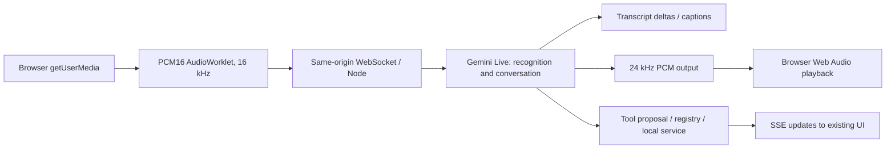

# Phase 1 repository audit

Baseline: `58f3eda`, branch `codex/local-file-tools`, clean working tree before this phase. No automatic commits or pushes are authorized.

## Actual stack and structure

- Plain HTML/CSS/browser ES modules, no React/Vite/TypeScript/build pipeline. `public/index.html` contains the existing voice, calendar and file panels; `public/app.js` owns voice/calendar state; `public/files.js` owns file results. CSS is in `public/style.css`.
- Node.js 20.11.0 in this environment, npm lockfile v3, ES modules. Express 4, `ws` 8, Google GenAI SDK 2.32.0, Ajv 8, Fuse 7 and JSONC parser 3. Reuse these dependencies.
- `server.mjs` is both HTTP and voice backend; `npm start` runs it; `npm run dev` uses Node watch mode. Express serves the frontend; there is no separate frontend process or build script.
- `calendar.mjs` keeps bookings in memory and atomically replaces a local JSON file on confirmation. Do not migrate existing data.
- `config.mjs`, `environment.mjs`, `config/business.json` configure business/voice and load credentials. Variable names include GEMINI_API_KEY, GEMINI_LIVE_MODEL, GEMINI_VOICE, VOICE_MAX_MINUTES, PORT, BUSINESS_CONFIG, CALENDAR_FILE and FILE_TOOLS_CONFIG. No values or credentials are reproduced here.
- `tools/` already includes a registry, file service, guard, native Windows launcher, fuzzy in-memory filename index, recursive watcher, result store, intent matching and audit wrapper. `test/*.test.mjs` uses Node's test runner; `checks/*.mjs` uses Playwright/Edge and isolated servers.

## Server execution map

Imports/config -> Calendar + FileService -> existing background filename scan -> JSON parser -> Host/Origin checks -> auto-issued `frontdesk` HttpOnly SameSite cookie -> routes/static files -> loopback listener. `/api/state` exposes public config and current browser state; `/api/events` streams SSE; calendar routes read availability, prepare draft and save only on confirmation. `/api/file-tools/:name` dispatches allowed local tools. `/api/voice` is an Origin/cookie-checked WebSocket upgrade.

Gemini calls the same `ToolRegistry.call` as file UI actions. The original registry checks Ajv input schemas and audits requests but has no independent policy authority. `FileService.act` checks result identity and recent text intent, then `tools/windows.mjs` uses Explorer to open/reveal. Original logs include raw arguments and session IDs. Original sessions have no server-side expiry and any valid-origin HTTP request can create a session. These are Phase 1 hardening targets.

## Gemini and voice pipeline

`server.mjs` creates GoogleGenAI using a server-only key. Model and named voice come from config. A single Live session uses audio responses, input/output transcription and NON_BLOCKING declarations. `response.toolCall` proposals are deduplicated, registry-dispatched and returned via `sendToolResponse`; cancellations skip stale results. There is a startup timeout and maximum conversation duration; no retry/resumption loop. Text history lives with the provider session, captions with the current page; neither is a persistent chat history database.

Recognition is provider-side, not browser SpeechRecognition. Microphone starts after a click and permission grant. There is no wake word/global hotkey/push-to-talk. Mute disables capture transmission; Finish stops tracks, playback and upstream transport. Interruption clears scheduled audio. The input transcript is trusted only as recognition of the authenticated audio stream, not as a transcription of documents. The original implementation does not separately brand user provenance, which this phase will address.

## Existing capabilities and gaps

Appointments, live conversation/captions, Indian English voice instructions, metadata-only filename search in allowed roots, typed search, expiring session IDs for results, Open/Show in folder UI and local audit files already exist. No file extraction, embeddings, SQLite, semantic/content search, file mutation, application registry execution or undo exists.

The guard already rejects traversal, sibling-prefix attacks, UNC/device paths, ADS, reserved names, symlinks/junctions and denied extensions; it checks canonical paths and file identity. Missing: protected system/credential paths, exclusions/never-touch/local-only precedence, future destination validation, unforgeable path/authorization capabilities, safe-handler restrictions independent of Windows associations, centralized risk and confirmation policy, redacted audits, and explicit cloud egress gating.

Frontend integration seams are the existing file panel, notifications/SSE and in-memory state. Add security headers and small confirmation controls only as needed; do not redesign. Retain calendar JSON storage, Gemini, cookie sessions and the loopback server.

## Baseline verification (executed before application edits)

| Command | Result |
|---|---|
| `npm test` | 18 passed, 0 failed, 0 skipped |
| `npm run test:files` | Passed: temporary files + mocked Gemini and Windows launch |
| `npm run test:voice` | Passed: fake microphone, SDK and provider double, PCM/captions/tools/shutdown |
| `npm run test:browser` | Passed: booking review/confirmation, Origin, microphone denial, responsive layout |
| `npm run test:config` | Passed: alternate business |

No lint, typecheck or build scripts exist. Integration servers prove non-destructive startup on loopback with in-memory booking storage and disposable file roots; they do not prove a live microphone/accent or real Gemini quota. Existing root tests used OS temporary folders; hard protected AppData policy requires relocating guarded fixtures to disposable workspace data, without weakening production path rules.

## Proposed additive changes and risks

Keep the current modules and insert security configuration, user authority, policy, confirmation, audit and cloud boundaries into their seams. Harden existing cookie lifecycle with same-origin bootstrap and CSRF headers; this is an extension of the current authentication approach, not a replacement login system. Keep metadata search as pre-existing functionality, with no new drive crawling/index implementation. Do not run the existing real-user scan during automated checks. Restrict open to explicitly trusted non-executing handlers; refuse unsupported associations. Protect document-derived data at egress, not just via prompts. See architecture/threat model for residual TOCTOU, local-user compromise and voice-recognition risks.
